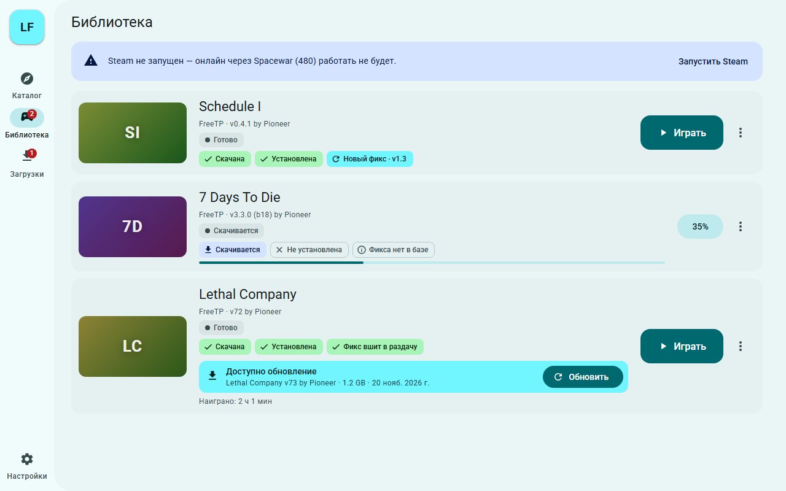
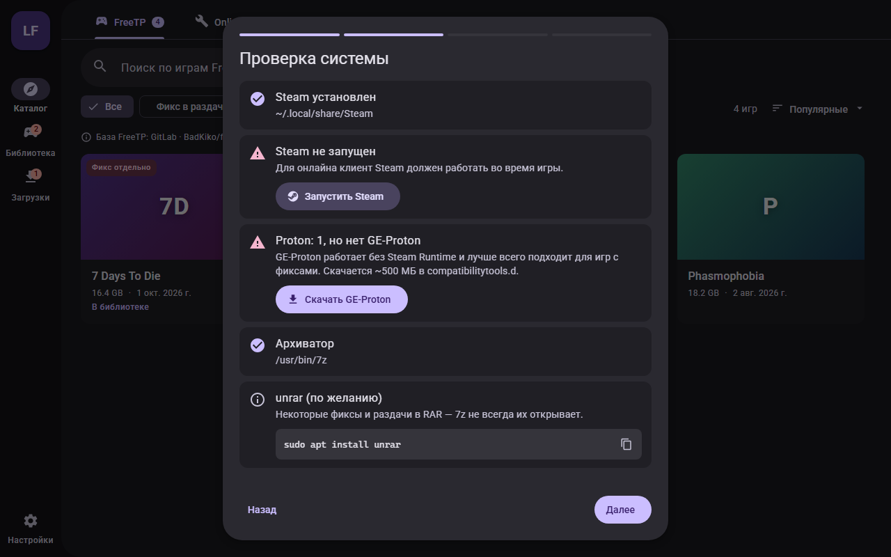

# LinFix

Лаунчер для Linux (и Windows): берёт игры из открытых каталогов **FreeTP** и **Online-Fix**, качает их встроенным торрент-клиентом, ставит каждую в отдельный префикс Proton и запускает с сетевой игрой через Steam (Spacewar, AppID 480). Регистрация не нужна.


## Скачать

Готовые сборки — на странице [**Releases**](https://github.com/ollezore/LinFix/releases/latest):

| Система | Файл | Как запустить |
|---|---|---|
| Любой Linux | `LinFix_*_amd64.AppImage` | `chmod +x LinFix_*.AppImage && ./LinFix_*.AppImage` |
| Ubuntu / Debian / Mint | `LinFix_*_amd64.deb` | `sudo apt install ./LinFix_*.deb` |
| Fedora / openSUSE | `LinFix-*.x86_64.rpm` | `sudo dnf install ./LinFix-*.rpm` |
| Windows 10/11 | `LinFix_*_x64-setup.exe` | запустить установщик |

Лаунчер сам предложит обновиться, когда выйдет новая версия.

**Для онлайна нужны** установленный и запущенный **Steam**, а на Linux — **Proton** (лучше GE-Proton: лаунчер скачает его кнопкой в «Настройки → Proton») и **7z**. При первом запуске мастер всё проверит и подскажет команды для вашего дистрибутива.

## Возможности

- **Два каталога** — вкладки FreeTP (~2900 игр, с отдельными фиксами) и Online-Fix (~2800 игр, фикс внутри раздачи). Поиск, «Популярные» и «Топ-100» по посещаемости FreeTP, сортировка по размеру и дате, обложки из Steam.
- **Установка в один клик**: торрент → распаковка архивов → установщик через Proton в отдельном префиксе → выбор exe → онлайн-фикс ставится сам (в т.ч. фиксы-установщики Inno Setup). Можно выбрать папку для каждой игры.
- **Варианты фиксов**: если для игры их несколько (разные версии, Steam / LAN), лаунчер даст выбрать; на карточке видно, какой стоит.
- **Обновления игр и фиксов**: лаунчер сравнивает библиотеку с базами и предлагает обновить. Новая раздача качается поверх старой — докачиваются только изменённые файлы, сохранения в префиксе остаются.
- **Запуск** через `proton waitforexitandrun` с окружением Spacewar, оверлеем Steam (Shift+Tab), своими аргументами, переменными и DLL overrides для каждой игры; по желанию — через umu-launcher.
- **Разделы Windows** (NTFS / exFAT): игры можно хранить там, префиксы Proton лаунчер положит в домашнюю папку.
- **Material Design 3**: динамический цвет (вся палитра из одного выбранного цвета), светлая / тёмная / системная тема. Работает без сети — иконки и шрифт встроены.

| Библиотека | Мастер первого запуска |
|---|---|
|  |  |

## Как это работает

1. **Каталог.** Ищете игру, выбираете раздачу и папку, нажимаете «Скачать».
2. **Загрузка.** Встроенный [librqbit](https://github.com/ikatson/rqbit) качает торрент в `<папка>/<игра>/download`. Если закрыть лаунчер, загрузка продолжится при следующем запуске.
3. **Установка.** Архивы (`.zip/.rar/.7z/.iso`) распаковываются через 7z; `setup.exe` / `install*.exe` запускается через Proton в префиксе игры; если установщика нет — игра портативная.
4. **Выбор exe.** Лаунчер показывает найденные exe (самые вероятные сверху).
5. **Фикс.** Для раздач FreeTP с отдельным фиксом он скачивается и ставится в папку игры. freetp.org закрыт Cloudflare и таймером — тогда фикс качается через встроенное окно браузера, кнопка нажимается сама.
6. **Запуск:** `proton waitforexitandrun game.exe` с `SteamAppId=480`, `SteamGameId=480`, `WINEDLLOVERRIDES="OnlineFix64=n;SteamOverlay64=n;winmm=n,b;dnet=n;steam_api64=n,b;winhttp=n,b"` и оверлеем Steam. Клиент Steam должен быть запущен.

На **Windows** Proton не нужен: установщики и игры запускаются напрямую (с UAC, если нужно), онлайн — так же через Spacewar.

### Источники каталогов

- FreeTP: [`games-arachnel.json`](https://gitlab.com/BadKiko/freetp-hydra-link) — обновляется примерно раз в неделю; `games.json` (формат Hydra) — запасной вариант.
- Online-Fix: [`hydralinks.cloud/sources/onlinefix.json`](https://hydralinks.cloud) (за Cloudflare — загружается через скрытое окно браузера), запасные зеркала на GitHub.

Лаунчер не хранит и не раздаёт игры сам — он только читает открытые каталоги и качает торренты, как обычный торрент-клиент.

## Сборка из исходников

### Linux — одной командой

```bash
bash build-linux.sh
```

Скрипт поставит зависимости (Debian/Ubuntu/Mint, Arch/Manjaro/CachyOS, Fedora/Nobara), Rust и Node.js, соберёт лаунчер в `dist/linfix` и добавит его в меню приложений.

### Вручную

```bash
# Debian / Ubuntu
sudo apt install libwebkit2gtk-4.1-dev build-essential curl wget file libxdo-dev \
  libssl-dev libayatana-appindicator3-dev librsvg2-dev cmake clang p7zip-full
# Arch
sudo pacman -S webkit2gtk-4.1 base-devel curl wget file openssl appmenu-gtk-module \
  libappindicator-gtk3 librsvg cmake clang 7zip unrar
# Fedora
sudo dnf install webkit2gtk4.1-devel openssl-devel curl wget file libappindicator-gtk3-devel \
  librsvg2-devel cmake clang p7zip p7zip-plugins
sudo dnf group install "c-development"

curl --proto '=https' --tlsv1.2 -sSf https://sh.rustup.rs | sh   # Rust

npm install          # Tauri CLI
npm run dev          # режим разработки
npm run build        # .AppImage / .deb / .rpm → src-tauri/target/release/bundle/
```

Интерфейс можно посмотреть без сборки: откройте `ui/index.html` в браузере — он запустится с демо-данными.

### Структура

```
ui/                 интерфейс (HTML/CSS/JS без сборщика, Material Design 3)
  theme.js          динамический цвет MD3
  wizard.js         мастер первого запуска
src-tauri/src/
  lib.rs            команды Tauri: библиотека, загрузки, установка, запуск, обновления
  catalog.rs        загрузка и разбор каталогов FreeTP / Online-Fix
  popular.rs        рейтинг популярности FreeTP
  covers.rs         обложки (Steam, постеры FreeTP)
  proton.rs         Steam / Proton / umu, запуск, оверлей
  files.rs          поиск setup/exe, распаковка, фиксы
  library.rs        модель игры, настройки, JSON-хранилище
```

Данные лаунчера: `~/.local/share/org.linfix.launcher/` (`library.json`, `settings.json`, кэш). Игры по умолчанию: `~/Games/LinFix/`.

## Как выпустить версию

1. Поднять версию в `src-tauri/tauri.conf.json` (и `package.json`, `src-tauri/Cargo.toml`), дописать `CHANGELOG.md`.
2. Закоммитить и поставить тег: `git tag v0.2.0 && git push --tags`.
3. GitHub Actions соберёт AppImage / .deb / .rpm / .exe и создаст **черновик** релиза — проверить и нажать «Publish». После публикации лаунчеры у всех предложат обновиться.

Для подписи обновлений в секретах репозитория должен быть `TAURI_SIGNING_PRIVATE_KEY` (содержимое приватного ключа; публичный — в `tauri.conf.json → plugins.updater.pubkey`).

## Ошибки и предложения

[Issues](https://github.com/ollezore/LinFix/issues) — приложите `proton.log` / `installer.log` из папки игры (меню игры → «Папка игры»).

## Лицензия

[GNU GPL v3.0 или новее](LICENSE). Шрифт Roboto — SIL Open Font License 1.1 (`ui/fonts/OFL.txt`), иконки Material Symbols — Apache 2.0.
