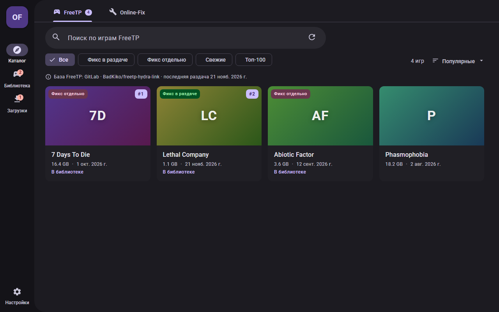

# OnlineFix-Launcher

Лаунчер, который скачивает игры с онлайн-фиксами (FreeTP и Online-Fix), сам их устанавливает и запускает так, чтобы можно было играть с друзьями по сети через Steam.

Работает на **Linux** (через Proton) и на **Windows**. Регистрация не нужна.



## Что умеет

- **Тысячи игр** в каталоге с поиском, «Популярными» и «Топ-100». Две вкладки: FreeTP и Online-Fix, можно выбрать, откуда качать.
- **Всё в одну кнопку:** скачает игру, распакует, запустит установщик, поставит онлайн-фикс.
- **Обновления:** сам скажет, когда вышла новая версия игры или фикса, и обновит без потери сохранений.
- **Онлайн через Steam:** игра запускается как Spacewar, работает оверлей Steam (Shift+Tab).
- **6 языков:** українська, русский, English, Deutsch, Polski, Español.
- Светлая и тёмная тема, цвет интерфейса на выбор.

## Установка

Скачайте файл для своей системы со страницы [**последнего релиза**](https://github.com/ollezore/LinFix/releases/latest).

### Linux

Самый простой вариант, подходит для любого дистрибутива: файл **`.AppImage`**.

```bash
chmod +x OnlineFix-Launcher_*.AppImage
./OnlineFix-Launcher_*.AppImage
```

Или пакет для своего дистрибутива:

- Ubuntu, Debian, Mint: `sudo apt install ./OnlineFix-Launcher_*.deb`
- Fedora: `sudo dnf install ./OnlineFix-Launcher-*.rpm`

### Windows

Скачайте и запустите **`OnlineFix-Launcher_*_x64-setup.exe`**.

## Перед первой игрой

Для игры по сети нужны:

1. **Steam.** Он должен быть установлен и **запущен** во время игры, а вы — войти в аккаунт.
2. **Proton** (только Linux). Лучше всего GE-Proton: лаунчер скачает его сам одной кнопкой.
3. **7-Zip** для распаковки фиксов. На Linux это пакет `p7zip` (`7z`).

При первом запуске откроется **мастер настройки**: он всё проверит, подскажет, чего не хватает, и покажет готовую команду установки для вашего дистрибутива.

## Как скачать и запустить игру

1. Откройте **Каталог**, найдите игру и нажмите на неё.
2. Выберите версию (если их несколько) и папку, нажмите **«Скачать»**. Прогресс видно во вкладке **«Загрузки»**.
3. Когда игра скачается, в **Библиотеке** нажмите **«Установить»**. Если откроется установщик игры, пройдите его как обычно.
4. Лаунчер спросит, **какой файл запускает игру**: подходящий будет сверху списка.
5. Онлайн-фикс поставится сам. На карточке игры зелёная галочка «Онлайн-фикс» значит, что всё готово.
6. Запустите Steam и нажмите **«Играть»**.

## Обновления

- **Лаунчер** сам проверяет новые версии и предлагает обновиться.
- **Игры и фиксы:** если вышла новая версия, на карточке в Библиотеке появится кнопка **«Обновить»**. Докачаются только изменённые файлы, сохранения останутся.

Каталог FreeTP обновляется примерно раз в неделю, поэтому совсем свежие игры могут появиться с задержкой.

## Если что-то не работает

**Нет онлайна или игра не видит друзей.** Проверьте, что Steam запущен и вы вошли в аккаунт. Оба игрока должны использовать одинаковую версию игры и фикса.

**Не открывается Shift+Tab.** Включите «Оверлей Steam» в лаунчере (Настройки → Proton) и в самом Steam (Настройки → В игре).

**Игра не запускается (Linux).** Скачайте GE-Proton (Настройки → Proton → «Скачать последнюю») и выберите его в параметрах игры (меню ⋮ → «Параметры запуска»).

**Фикс не скачался.** Сайт freetp.org иногда просит подтвердить, что вы не робот. В открывшемся окне подождите около 30 секунд, кнопка нажмётся сама. Если не помогло, откройте меню игры → «Страница на FreeTP» и скачайте фикс вручную.

**Игры на диске Windows (NTFS) в Linux.** Так можно: лаунчер сам положит служебные файлы Proton в домашнюю папку.

Не помогло? Создайте [**issue**](https://github.com/ollezore/LinFix/issues) и приложите файл `proton.log` из папки игры (меню игры → «Папка игры»).

| Библиотека | Мастер настройки |
|---|---|
|  |  |

## Откуда берутся игры

Лаунчер ничего не хранит и не раздаёт сам. Он читает открытые каталоги и скачивает игры торрентом, как обычный торрент-клиент:

- **FreeTP:** каталог [freetp-hydra-link](https://gitlab.com/BadKiko/freetp-hydra-link);
- **Online-Fix:** каталог [hydralinks.cloud](https://hydralinks.cloud).

Это неофициальный проект, он не связан с командами FreeTP и Online-Fix.

<details>
<summary><b>Для разработчиков</b></summary>

### Сборка

На Linux одной командой: скрипт сам поставит зависимости, Rust и Node.js.

```bash
bash build-linux.sh        # → dist/onlinefix-launcher + ярлык в меню
```

Вручную: нужны Rust, Node.js и зависимости Tauri ([список](https://v2.tauri.app/start/prerequisites/)), затем:

```bash
npm install
npm run dev      # режим разработки
npm run build    # .AppImage / .deb / .rpm / .exe → src-tauri/target/release/bundle/
```

Интерфейс можно открыть без сборки: `ui/index.html` в браузере запустится с демо-данными.

### Устройство

Tauri 2: интерфейс на HTML/CSS/JS без сборщика (`ui/`), логика на Rust (`src-tauri/src/`).

| Файл | Что делает |
|---|---|
| `ui/app.js` | интерфейс: каталог, библиотека, загрузки, настройки |
| `ui/wizard.js` | мастер первого запуска |
| `ui/theme.js` | цвета Material Design 3 |
| `ui/i18n.js`, `scripts/translations.py` | переводы (таблица → `ui/locales/*.js`) |
| `src-tauri/src/lib.rs` | команды: загрузки, установка, запуск, обновления |
| `src-tauri/src/catalog.rs` | каталоги FreeTP и Online-Fix |
| `src-tauri/src/proton.rs` | Steam, Proton, запуск игр |
| `src-tauri/src/files.rs` | поиск exe, распаковка, фиксы |

Данные лаунчера: `~/.local/share/org.linfix.launcher/`.

### Перевод

Все строки лежат в одной таблице `scripts/translations.py`: русский текст и переводы в колонках. После правки выполните `python scripts/translations.py`. Новый язык — новая колонка плюс строка в `ui/i18n.js`.

### Выпуск версии

1. Поднять версию в `src-tauri/tauri.conf.json`, `package.json`, `src-tauri/Cargo.toml` и дописать `CHANGELOG.md`.
2. `git tag vX.Y.Z && git push --tags`
3. GitHub Actions соберёт файлы и создаст черновик релиза: проверить и нажать «Publish».

Для подписи обновлений в секретах репозитория нужен `TAURI_SIGNING_PRIVATE_KEY`.

</details>

## Лицензия

[GNU GPL v3](LICENSE). Шрифт Roboto — SIL OFL 1.1, иконки Material Symbols — Apache 2.0.
